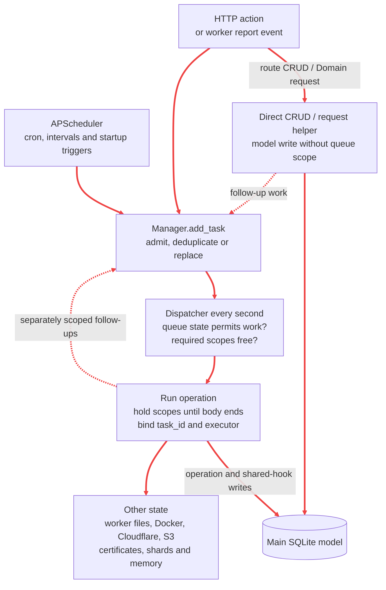
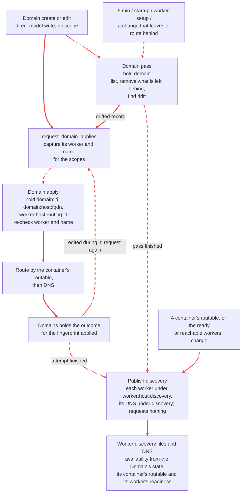
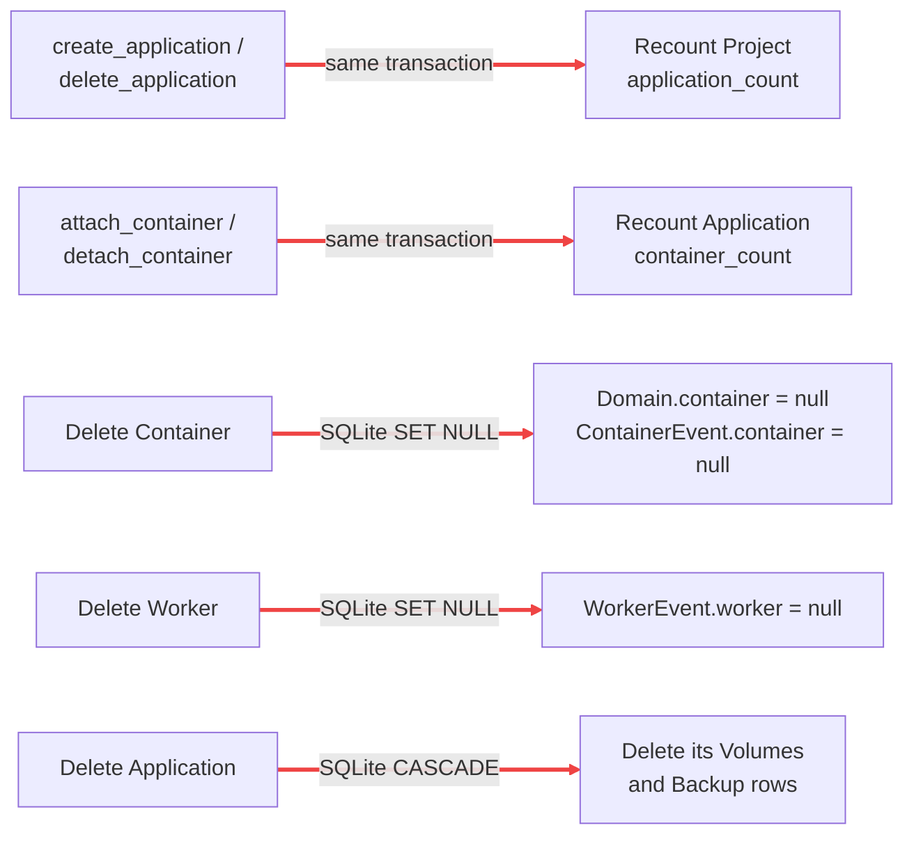
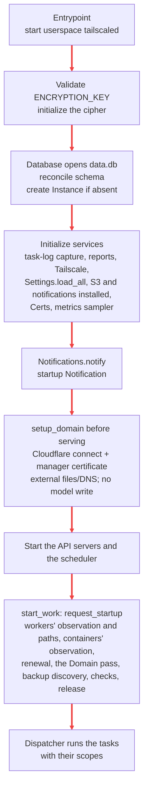

# Scheduler and data writes

This is the reference for **what starts work, which work can overlap, and which state it changes**.
The diagrams show the main flows; the tables list every queued operation and the writers outside the queue.
Names in code font are searchable function, task or model names.

- [Execution flow](#execution-flow)
- [Scopes and admission](#scopes-and-admission)
- [Scheduler timetable](#scheduler-timetable)
- [Task catalog](#task-catalog)
- [Follow-up flows](#follow-up-flows)
- [Synchronous routes](#synchronous-routes)
- [Startup and other writers](#startup-and-other-writers)
- [Model writer index](#model-writer-index)
- [Consistency boundaries](#consistency-boundaries)

## Execution flow

**Scopes protect queued task bodies. Direct route writes do not acquire queue scopes.** A task's executor
chooses its pool for blocking work; it does not determine which other tasks are excluded.

The scheduler's container and backup triggers read rows to select work; the dispatcher itself enqueues nothing.
A worker's report tells the pages of what it changed, and a change of the ready workers requests discovery.
[Startup, ingestion and service threads](#startup-and-other-writers) have additional write paths, including Vector's
direct writes to log shards.

Task completion, failure and pending-task cancellation can create a `Task` row. **Quiet tasks record only
failure** and retain task-log lines only on failure. `Notifications.notify` writes a `Notification` immediately in
its caller, then hands webhook delivery to a separate pool. Those shared effects are additional to the
operation-specific writes below; ordinary log statements do not create notifications.

Sources: [scheduler](../app/scheduler.py), [queue engine](../app/utils/queue.py),
[history writer](../app/services/history.py), [notification writer](../app/services/notification.py),
[pools](../app/utils/executor.py).

## Scopes and admission

`<id>` is a Domain ID;
`<manager>` is `TS_NAME`. Braces mean **all** listed scopes are held together.

| Scope | Excludes | Does not exclude by itself |
| --- | --- | --- |
| `domain:<id>` | Work for that record, and tasks holding root `domain` | Other records |
| `domain:host:<fqdn>` | The apply of any record with that full name, so a name swapped between two records is applied by one at a time | Other names |
| `domain` | Every Domain apply, and every other task holding it: the Domain pass, maintenance | Worker and application tasks |
| `worker:<host>` | Work on that worker and every scope below it: its containers, its stack, its routes and its discovery files | Other workers |
| `worker:<host>:container:<id>`, `worker:<host>:stack`, `worker:<host>:routing:<id>`, `worker:<host>:discovery`, `worker:<host>:tls` | That one and `worker:<host>` | Their siblings: a container's operations, the stack's repair, a Domain's route, the discovery files and the certificate files on the same worker |
| `certificate:worker:<host>` | That worker's certificate copy, and `certificate` | Other workers' copies |
| `discovery` | The discovery DNS publication | Every other root, the workers' discovery files included |
| `certificate` | The certificates' renewal, and every task under it | Worker, domain and application work |
| `settings:<section>` | That section's check | Other sections' checks |
| `release` | The release check | The other roots |
| `metrics:flush` | The metrics flush, and root `metrics` maintenance | The other roots |
| `backup:store:<identity>` | The store's discovery and retention, and every archive's write, read or deletion in that store | Other stores' work |
| `backup:store:<identity>:write:<part>` | That archive write and the store's root | Other archives' work in the store |
| `backup:store:<identity>:archive:<part>` | A restore from that archive, its deletion, and the store's root | Other archives' work in the store |
| `metrics` | All metric flushes and maintenance | The other roots |

A Domain's apply holds its route's scope under its worker, not its container's: it does not wait for the container's
operations, and the worker's convergence and reboot exclude it. The `common` pool has one thread;
async task bodies can still overlap while their offloads wait for it. Pool size is not a lock.

The platform restore holds no scope: it is the queue's own entry and starts once nothing runs or waits.

| Admission | Effect on an operation with the same **key** (by default its name, subject ids and intent; a container's lifecycle requests share `("lifecycle", <container id>)`), whatever its scopes |
| --- | --- |
| `DEDUP` | A pending task with the key, else a running one, does the request (`existing`, with its id); otherwise enqueue. Default. |
| `REPLACE` | Supersede the pending tasks with the key, even on other scopes; keep a running one and queue its successor. |
| `REVISE` | `busy` (with the running task's id) while a task with the key runs; otherwise supersede the pending ones and enqueue. |
| `QUEUE` | Keep every request. |

Pending tasks can be cancelled by key, name, or a scope and the scopes below it (`cancel_tasks`); the Manager cancels a container's queued Deploy, Stop or Delete on request, and every queued task of a container when it is deleted.

A visible request joining a quiet task with its key makes that task visible. Conflicting scopes defer admitted work; they do not reject it. Pending tasks reserve no scopes, so a broad
task can wait while later work starts. Paused queues admit work but start nothing; restoring starts only the
restore; stopping cancels pending/new work and drains running tasks. The main API refuses mutations while
the queue is not running, except pause/resume. The separate ingestion API keeps accepting pushes.
See [queue semantics](backend.md#operation-queue) and [pause/restore/stop](backend.md#pause-and-stop).

## Scheduler timetable

Times below are **the manager process's scheduler timezone**: `AsyncIOScheduler` has no explicit timezone
override. Volume crons are matched against naive UTC from `utcnow()`. They agree when the manager uses UTC.
Cron rows fire at wall-clock boundaries; interval rows run relative to scheduler start. These are enqueue
times, not execution deadlines. APScheduler coalesces missed fires, permits one instance per trigger, and
uses a 30-second misfire grace period.

| Trigger | Cadence | Also once at scheduler startup? | Work selected |
| --- | --- | --- | --- |
| `dispatch_tick` | Interval 1 s | No | Start eligible queued operations; no task of its own |
| `observe_workers` | Interval 30 s | Yes | `observe_workers` |
| `refresh_worker_paths` | Interval 60 s | Yes | `refresh_worker_paths` |
| `observe_containers` | Every minute, `* * * * *` | Yes | `observe_containers` |
| `list_container_records` | Every 10 minutes, `*/10 * * * *` | No | One `list_records` per worker whose report is current |
| `schedule_application_backups` | Every minute, `* * * * *` | No | One `backup_preserve` per container of an application with due volumes; nothing without a store |
| `flush_metrics` | Every minute, `* * * * *` | No | `request_metrics_flush`: `flush_metrics` |
| `reconcile_domains` | Every 5 min, `*/5 * * * *` | Yes | `reconcile_domains` |
| `check_settings` | Every 5 min, `*/5 * * * *` | Yes | `request_settings_checks`: a quiet `check_<section>` for each configured section |
| `refresh_latest_release` | Every 4 h, `0 */4 * * *` | Yes | `request_release_check`: a quiet `refresh_latest_release` |
| `backup_database` | 00:00 and 12:00, `0 */12 * * *` | No | `backup_platform`; nothing without a store |
| `renew_certificates` | Daily 03:00, `0 3 * * *` | Yes | `renew_certificates` |
| `cleanup` | Daily 04:00, `0 4 * * *` | No | `request_cleanup`: independent quiet tasks, `metrics_cleanup`, `logs_cleanup`, `purge_history` and `prune_backups` (nothing without a store) |
| `send_summary_notification` | Daily 08:00, `0 8 * * *` | No | `request_summary`: `send_summary_notification`; nothing without a notification channel |
| `start_work` | Startup only | Yes | `request_startup`: the workers' observation and paths, the containers' observation, certificate renewal, the Domain pass, backup discovery, the settings checks, the release check; also after a platform restore |

A volume is due when its `Volume.backup_cron` matches the UTC minute and no Backup of it was recorded in that minute;
each container of its application gets one automatic backup of the application's due volumes.
`croniter` uses Sunday = 0 for these expressions; APScheduler's numeric weekday 0 means Monday.
Sources: [trigger definitions](../app/scheduler.py), [due-volume selection](../app/services/manager/backups.py).

## Task catalog

Each operation appears once below, with source-dependent admission variants in its row. **Q** means quiet;
**H** means normal terminal history. Sources listed as follow-ups enqueue independent tasks. An inline call
is part of its caller and acquires no additional scope. Table effects exclude the shared Task/Notification
effects described [above](#execution-flow).

### Applications and volumes

Implementation: [container lifecycle](../app/services/manager/containers.py),
[container requests and their steps](../app/services/manager/lifecycle.py),
[backup/restore operations](../app/services/manager/backups.py).
Route paths use `<app>` for `/projects/{project}/applications/{application}`; all paths are under `/api`.

| Operation | Scopes · executor | Admission / history | Every initiating source | Model writes and other effects |
| --- | --- | --- | --- | --- |
| `deploy` (`deploy_container`) | `worker:<host>:container:<id>` · app | REVISE on `("lifecycle", <id>)` / H | `request_deploy`, `request_deploy_all` | ContainerEvents (admitted, rejected, succeeded, failed); no other main-DB write. Reads and writes the worker's `record.json`; stops the container, writes `.env`, secrets, Compose file and volume directories, `compose up`, verifies; the `Containers` owner holds the record. |
| `stop` (`stop_container`) | `worker:<host>:container:<id>` · app | REVISE on `("lifecycle", <id>)` / H | `request_stop`, `request_stop_all` | ContainerEvents; the worker's `record.json`; `compose down`, verifies nothing runs. |
| `delete` (`delete_container`) | `worker:<host>:container:<id>` · app | REPLACE on `("delete", <id>)`, after cancelling the container's queued tasks / H | `request_delete` | ContainerEvents; the worker's `record.json`; `compose down --volumes --rmi local --remove-orphans`, removes the placement directory; then deletes the Container row through `detach_container` (unlinks its Domains) and requests their applies and, when it unlinked any, `reconcile_domains`. Force on a worker that can't be asked: only the row. |
| `observe_containers` | none · app | DEDUP / Q | Every minute | No main-DB write. Decides every container's state, tells the pages of those whose state changed, and asks for each container's correction: a record read, a recovery or a reset. Holds each recovery's first-seen time. |
| `recover` (`recover_container`) | `worker:<host>:container:<id>` · app | DEDUP on `("recover", <id>)` / H | `observe_containers`: at an interrupted operation or unreadable record, then once its allowance has passed | ContainerEvents; the worker's `record.json` (recovering, then settled stopped/failed); `compose down` and the check. An interrupted automatic backup: `compose stop` at once, then `compose start` back to its baseline with its settled outcome kept, or stopped and settled failed when it does not come back or its authority is from before a platform restore. |
| `reset` (`reset_container`) | `worker:<host>:container:<id>` · app | DEDUP on `("reset", <id>)` / H | `observe_containers`: a runtime that contradicts its record, or a record from before a restore | ContainerEvents; reads the record and inspects the runtime again; `compose down`, the check, the record with the cause. |
| `read_record` | `worker:<host>:container:<id>` · app | DEDUP / Q | `observe_containers` (a record never read, or whose read failed while the worker reports); `list_records` (a listed record that differs) | No main-DB write. Reads the container's `record.json`; the `Containers` owner holds it. |
| `list_records` | none · app | DEDUP / Q | Every 10 minutes, for each worker whose report is current | No main-DB write. Lists every placement directory and record on the worker; requests `read_record` for a container whose listed record differs from the held one and `cleanup_orphan` for this Sage's placements with no row. |
| `cleanup_orphan` | `worker:<host>:container:<id>` · app | DEDUP on `("cleanup_orphan", <host>, <id>)` / H | `list_records`; `observe_containers` (a reported runtime labelled as this Sage's with no row) | No main-DB write. Re-checks the row and the owner; `compose down --volumes --rmi local --remove-orphans` by project name, the check, removes the placement directory. Waits out an unsettled operation's allowance first. |
| `backup_stopped` (`backup_container`) | `worker:<host>:container:<id>`, `backup:store:<identity>:write:<id>` · app | REVISE on `("lifecycle", <id>)` / H | `request_backup`: one per container of the application, refused unless every one is stopped | ContainerEvents; the worker's `record.json` (stopped/succeeded, or the failure); one Backup per archive uploaded (`storage_id`). Refused when the store changed, it runs or it was never deployed. |
| `backup_preserve` (`backup_container_preserving`) | `worker:<host>:container:<id>`, `backup:store:<identity>:write:<id>` · app | DEDUP on `("backup_preserve", <id>)` / H | `request_automatic_backups`, each minute, for the containers of an application with due volumes | ContainerEvents; the record's operation with its baseline; `compose stop`, the archives, `compose start` and the check of the same Docker containers; one Backup per archive uploaded. Settled outcome kept unless the runtime does not come back (then stopped/failed). Refused when its last action failed, its runtime disagrees, or the store changed. |
| `restore_stopped` (`restore_container`) | `worker:<host>:container:<id>`, `backup:store:<identity>:archive:<part>` · app | REVISE on `("lifecycle", <id>)` / H | `request_restore`: a backup of one of the application's volumes into any volume of a container of that application, on any worker | ContainerEvents; the worker's `record.json` (stopped/succeeded, or stopped/failed with Deploy allowed); `restore.sh` replaces the container's copy of the volume. No Backup row. Refused when the store changed, it runs, or the backup or volume is gone; a container never deployed can receive it. |

A change of whether a container with a service's Domain can be routed to publishes discovery again. The resource commands tell the affected pages after their commit; container log markers go
to the application's log shard on `LOGS_EXECUTOR`. No deployment follows an ordinary configuration edit.

### Domains and discovery

Implementation: [Domain operations and request helpers](../app/services/manager/domains.py).

| Operation | Scopes · executor | Admission / history | Every initiating source | Model writes and other effects |
| --- | --- | --- | --- | --- |
| `apply_domain` | `domain:<id>`; `domain:host:<fqdn>` when it has a name; `worker:<host>:routing:<id>` when it routes to a worker · app | REPLACE on `("apply_domain", <id>)` / Q | `request_domain_applies`: a Domain's create and edit (`domain_edited`, which requests `reconcile_domains` too); the end of a container's Deploy or Stop, either one's failure, and its Delete (the Domains it unlinked); `observe_containers` when a container becomes routable or stops being; a worker's subdomain change (its internal and TCP Domains); `reconcile_domains` (a Domain in error, drifted or not applied); its own follow-up after an edit during it or a move before it | No main-DB write. `domain-<id>.yml` on its worker: written while its container is routable, removed once it is not or the Domain is unlinked, left as it is while that is unknown or the worker is not reachable and set up. Then its `sage-domain-<id>` DNS records: a linked public name's CNAME to its worker's tunnel, none otherwise. The `Domains` owner holds the outcome for the fingerprint applied (a success only when the route was applied too) and what it did to the route and DNS. A failure fails the task and is not retried by itself. |
| `reconcile_domains` | `domain` · app | REPLACE on `("reconcile_domains",)` / Q | `request_domain_reconciliation`: every 5 min and startup; the end of a worker's setup; a container Delete that unlinked Domains; Domain edits and deletes | No main-DB write. Lists the routing files on each worker reachable and set up, the zone and the tunnels, then reads the Domain rows. Removes the routing files of Domains gone or bound to another worker (one `rm -f` per worker) and the `sage-domain-<id>` records of Domains gone. `Domains` holds each Domain's route on its worker and whether its DNS conforms, and drops what it held of Domains gone. Requests `apply_domain` for each Domain in error, drifted or not applied. A failed listing or removal fails the task after the rest ran. |
| `publish_discovery` | `worker:<host>:discovery` · app | REPLACE on `("publish_discovery", <host>)` / Q; forced on its own key with `"force"` / H | `request_discovery`, for each worker reachable and set up (forced: one worker's resync): the end of every Domain apply and Domain pass; `observe_containers` when whether a container with a service's Domain can be routed to changed; a change of the ready workers or of those reachable and set up (worker observation and reports) | No main-DB write. Re-checks the worker; reads its `discovery` stamp and lists its `_discovery-*.yml` files; when either differs from the current services, writes each service's file, removes the stale ones, then writes the stamp. Requests nothing. |
| `publish_discovery_dns` | `discovery` · app | REPLACE on `("publish_discovery_dns",)` / Q | `request_discovery`, with every request | No main-DB write. One zone listing: `discovery.int.<domain>` A records to each worker reachable and set up under `sage-discovery-<host>` (any other worker's deleted), and `discovery.<domain>` CNAME to the platform tunnel under `sage-tunnel`. |

A request writes nothing: a Domain's status is decided when it is read. See the [Domain flow](#domain-apply-and-discovery).

### Workers and certificates

Implementation: [worker operations](../app/services/manager/workers.py),
[certificate operations](../app/services/manager/certificates.py).

| Operation | Scopes · executor | Admission / history | Every initiating source | Model writes and other effects |
| --- | --- | --- | --- | --- |
| `observe_workers` | none · app | DEDUP / Q | Interval 30 s | No main-DB write. Asks every configured worker's SSH server (`Tailscale.observe_workers`), drops the setup outcome of a worker that stopped answering, tells the pages of the workers whose state changed (observed status changes are WorkerEvents), and requests `converge_worker` and `repair_worker_stack`. |
| `converge_worker` | `worker:<host>` · app | DEDUP / Q; force on its own key `("converge_worker", <host>, "force")` / H | `observe_workers` (not set up since the start or since it came back, a new address, a failed or refused setup after the retry time); force: the worker's resync (Resync workers queues it for every worker) | No main-DB write. Owner stamp; removes the routing files of Domains gone or bound to another worker; worker tunnel and `*.<subdomain>.int` record (Cloudflare), the stack's files, `compose up --wait` and restarts and the infra stamp when it differs or on force, else `compose up -d`; the setup outcome and applied address in `Workers`, and the proofs of its `certs` stamp; WorkerEvents. Requests `renew_certificates` when its own or the discovery certificate does not cover its names, else `distribute_certificates` when it did not apply the current ones; once set up, `reconcile_domains`. Forced (the worker's resync), then also a forced `distribute_certificates`, `apply_domain` for the Domains routed to it and a forced `publish_discovery` on it. |
| `repair_worker_stack` | `worker:<host>:stack` · app | DEDUP / Q | `observe_workers`: set up but not ready for its stack, Traefik or a minute's silence, once per cooldown | No main-DB write. `compose up -d` of the stack's services; a repair WorkerEvent when it started something. |
| `add_worker` | `worker:<host>` · app | DEDUP / H | `request_add_worker`: the machine the tailnet lists by that hostname or Tailscale IP, not the manager's name; the command writes the row first | Looks at the worker, then the first convergence inline; WorkerEvents. A worker whose first setup fails is kept. |
| `remove_worker` | `worker:<host>` · app | DEDUP / H | `request_remove_worker` (refused with containers or internal domains) | Deletes the Worker row through its command; stops the stack and removes Sage's home when it answers and is this Sage's; deletes its DNS records and tunnel; the sources forget it; WorkerEvents. |
| `reboot_worker` | `worker:<host>` · app | DEDUP / H | `request_reboot` | No main-DB write but WorkerEvents. Boot id before, one reboot, the boot id again until a new one, inline convergence, readiness on a report after the new boot, within `WORKER_REBOOT_LIMIT_SECONDS`; application log markers. |
| `refresh_worker_paths` | none · app | DEDUP / Q | Interval 60 s and startup | No main-DB write. Pings the reachable workers for their paths and tells the pages of the workers whose state changed. |
| `renew_certificates` | `certificate` · platform | REPLACE on `("renew_certificates",)` / H | `request_certificate_renewal`: daily 03:00 and startup; a worker's removal or subdomain change; a worker's setup when its own or the discovery certificate does not cover its names; successful restore; a worker's resync when its certificates do not cover its names | No main-DB write. The worker names from the Worker rows; then one certificate at a time: retire what no longer covers its names (a removed worker's found on disk included), revoking its public leaf, and issue what is missing or due; the manager's TLS reloaded in place when it was issued; then `distribute_certificates` requested for each worker reachable and set up. A failed retirement holds back that certificate's issue only; any failure fails the task after the rest ran. |
| `distribute_certificates` | `certificate:worker:<host>`, `worker:<host>:tls` · app | REPLACE on `("distribute_certificates", <host>)` / Q; forced on its own key with `"force"` / H | `request_certificate_distribution`: the end of `renew_certificates`, for each worker reachable and set up; `converge_worker` when the worker did not apply the current certificates; forced: the worker's resync | No main-DB write. Re-checks the worker; reads its `certs` stamp, its managed files and its `certs.yml` digest; when any differs (or forced), copies each valid pair, writes the list, removes unwanted files, then the stamp; `Workers` holds the proofs applied. |

A worker's subdomain change (`set_worker_subdomain`, then `worker_subdomain_changed`) runs in the
[worker update route](#synchronous-routes).

### Platform, settings and maintenance

Implementation: [platform operations](../app/services/manager/platform.py),
[settings checks](../app/services/manager/settings.py), [release](../app/services/releases.py),
[summary](../app/services/manager/summary.py), [history](../app/services/history.py), [metrics](../app/services/metrics/__init__.py),
[log maintenance](../app/services/logs/store.py).

| Operation | Scopes · executor | Admission / history | Every initiating source | Model writes and other effects |
| --- | --- | --- | --- | --- |
| `backup_platform` | `backup:store:<identity>:write:platform` · platform | REPLACE on `("backup_platform",)` / H | `request_platform_backup`: 00:00/12:00; POST `/backups`; nothing without a store | `Database.snapshot` (configuration only: history and Backup rows emptied, compacted), encrypted and uploaded; a platform Backup row with the key uploaded. Runs alongside other work. Refused when the store changed. |
| `restore_platform` | none · platform | The queue's own entry (`TaskQueue.request_restore`), outside admission: refused unless running; from then on every other request is refused, the tasks queued before it finish, and it starts alone once nothing runs or waits / H | `request_platform_restore`: POST `/backups/{backup}/restore` (a platform backup of the configured store) | A pseudo restart: `Database.install` (safety copy, the backup copied in, schema reconciled, fresh `state_generation`, history and Backup rows emptied; rollback on failure), the configured S3 settings kept, the other consumers installed, the memory of the old configuration cleared; then `end_restore` and, on success, `request_startup`. The workers' reports are refused with 503 while restoring. |
| `discover_backups` | `backup:store:<identity>` · common | REPLACE on `("discover_backups",)` / H | `request_backup_discovery`: startup; POST `/backups/discover`; PUT `/settings/s3`; successful restore; nothing without a store | Lists the store, then reads the rows, and makes the table mirror the store in one transaction (`reconcile_catalog`, `apply_catalog`): rows of another store or of a gone object dropped, listed backups added, a volume archive only while its volume is configured (by its id). Archives being deleted are left out. Nothing when the store changed since the request. |
| `delete_archive` | `backup:store:<identity>:archive:<part>` · common | DEDUP on `("delete_archive", <s3 path>)` / H | `request_backup_deletion`: DELETE `/backups/{backup}` (a platform backup); it first deletes the Backup row (`remove_backup`) | Deletes exactly that key from the store the row named; refused when that is no longer the configured store, so another store's object of the same key is never touched. |
| `prune_backups` | `backup:store:<identity>` · common | REPLACE on `("prune_backups",)` / Q | `request_backup_retention`, daily 04:00 | Deletes the store's platform backups and volume archives older than `config.RETENTION_DAYS` (14), then the rows of those deleted, a prefix that failed failing the task after the other. Nothing when the store changed. |
| `check_<section>` → `check_setting` | `settings:<section>` · common | REPLACE on `("check_<section>",)`; `request_settings_checks` Q, `settings_saved` H | `request_settings_checks`: every 5 min and startup, for configured sections; `settings_saved`: PUT `/settings/{s3,notifications}` when complete | No main-DB write. Records the check for the revision it checked (`Settings.record_check`; dropped when the section was saved meanwhile). The Cloudflare check keeps every tunnel's health (`Cloudflare.tunnel_health`) and checks the worker states again. Sections: tailscale, cloudflare, s3, notifications. |
| `refresh_latest_release` → `Releases.refresh` | `release` · common | REPLACE on `("refresh_latest_release",)`; schedule and startup Q, POST H | `request_release_check`: every 4 h and startup; POST `/info/release/refresh` | No main-DB write. Fetches GitHub's latest release and keeps it and its version in memory (`Releases`), pushing `release`, and `latest_version` when the version is new; a failed fetch keeps the last. |
| `send_summary_notification` | none · common | REPLACE on `("send_summary_notification",)` / H | `request_summary`: daily 08:00; nothing without a notification channel | No main-DB write. `get_system_summary` (the workers, containers and Domains by their states now, the last 24 hours' deploys, backups and error and warning notices) dispatched to the channels; an error when a notice was, or a container or Domain is in error or a worker offline, a warning when a notice was or a worker is otherwise not online. **No Notification row** for the summary. |
| `flush_metrics` → `Metrics.flush` | `metrics:flush` · metrics | DEDUP on `("flush_metrics",)` / Q | `request_metrics_flush`: every minute | No main-DB write. Writes the completed minutes of the manager's samples and of each worker's reports to their metric shards (`WorkerMeta`, `WorkerMetrics`, `ContainerMetrics`); keeps each worker's newest written minute (`Metrics.newest`), dropped by a flush that writes none for it, and fires `worker_list` and that worker's `worker_entry` when it changed. Never crosses `metrics_cleanup`, which holds `metrics`. |
| `metrics_cleanup` → `Metrics.cleanup` | `metrics` · metrics | REPLACE on `("metrics_cleanup",)` / Q | `request_cleanup`: daily 04:00 | No main-DB write. Delete old metric rows and orphan host shards; read Worker rows to identify live hosts. |
| `logs_cleanup` → `Logs.cleanup` | none · common | REPLACE on `("logs_cleanup",)` / Q | `request_cleanup`: daily 04:00 | No main-DB write. Delete old log/request/task-log lines and orphan application shards; trim size limits and optimize indexes. |
| `purge_history` | none · common | REPLACE on `("purge_history",)` / Q | `request_cleanup`: daily 04:00 | Deletes the history (ContainerEvent, WorkerEvent, Notification and Task rows) older than `config.RETENTION_DAYS` (14). Holds no scope; one queued before a platform restore runs first, and none is queued while it waits or runs. |

## Follow-up flows

### Domain apply and discovery

Solid arrows show work within a path; dashed arrows enqueue a separate task. A parent never waits for a child
while holding `domain`, since that scope excludes every child's `domain:<id>`.

A Domain whose worker or name changed after its request is requested again with the right scopes before any I/O. A
container's operation does not hold the apply back: the route follows its `routable` when the apply runs, and a change
of that requests the apply again. Failed applies, and routes left because the worker could not be written to or the
container's state was not known, wait for the Domain pass. Discovery's publication only reads results and requests
no apply, so a failed apply cannot form a retry loop through it. Domain apply proof and discovery availability remain
separate facts.

### Application and worker events

| Event / writer | Immediate state change | Queued consequence |
| --- | --- | --- |
| Deploy or Stop end, or the failure of either | The worker's `record.json` | Apply the container's Domains |
| `observe_containers`: a container becomes routable or stops being | None | Apply its Domains (a change between known values); publish discovery (any change, its becoming known included, of a container with a service's Domain) |
| Successful container delete | `detach_container` deletes the row, which unlinks its Domains, and recounts the application's containers | Apply the unlinked Domains; the Domain pass when there were any |
| A worker's readiness changes | None | Publish discovery; the Domains routed to it are shown again |
| Worker setup or offline transition | The setup outcome and applied address in `Workers`, no row write; remote convergence, which removes the routing files of Domains gone or bound elsewhere | After a setup, the Domain pass; publish discovery when the workers reachable and set up, or their addresses, change, its DNS membership with them |
| Worker subdomain edit | Worker row | Convergence; apply its internal and TCP Domains, whose ends publish discovery; renewal |
| Worker setup whose own or discovery certificate does not cover its names | None | Certificate renewal |
| Worker removal | Deletes the Worker row | Certificate renewal, which retires its leaf |
| Domain apply ends | `Domains` holds its outcome for the fingerprint applied | Apply again when the Domain was edited during it; publish discovery |
| Domain pass ends | `Domains` holds what it saw of each Domain's route and DNS | Apply each Domain in error, drifted or not applied; publish discovery |

A queue Fact's callback enqueues nothing; the worker state Fact, checked at each observation and report, requests
discovery. [Worker workflows](../app/services/manager/workers.py) and
[container workflows](../app/services/manager/containers.py) own these triggers.

## Synchronous routes

**No queue scopes are held by these writes**, even if they call a Manager helper. All paths have `/api`
prefix; `<app>` has the expansion given in the catalog. Notifications, requests, tasks and info expose no
ordinary CRUD writer beyond the action routes already listed.

| Route | Rows/fields written before the response | Immediate or queued consequence |
| --- | --- | --- |
| POST `/projects` | Project (`create_project`): `name` derived from `label`, `label`, `description` | None |
| PUT `/projects/{project}` | Project `label`, `description`, `env` (`patch_project`) | Tells the pages of its applications and their workers; deploy inputs apply at the next deploy |
| DELETE `/projects/{project}` | Delete Project; refused while it has applications | None |
| POST `<app collection>` | Application (`create_application`): `name` derived from `label`, `label`, `description`; the project's `application_count` | Tells the application's page |
| PUT `<app>` | Application `label`, `description` and deploy configuration (`type`, `image`, `repo`, `path`, `env`, `args`, `build_secrets`, `command`) through `patch_application`: type-dependent fields derived, image and repo checked | Tells the pages of the application and its workers; no deploy queued, so its containers show their configuration changed |
| DELETE `<app>` | Delete Application; refused while it has containers; the project's `application_count` | Cascades its Volumes and Backup rows; S3 archives stay until retention |
| POST `<app>/containers` | Container (`attach_container`): its application and worker, one per worker; the application's `container_count` | Tells the pages of the application and its worker and the Domains page; no deploy or Domain work |
| POST/PUT/DELETE `<app>/volumes[/{volume}]` | Volume (`create_volume`, `patch_volume`, `delete_volume`): `name`, `path`, `backup_cron` | Tells the application's page; no remote volume operation. A deploy uses the current mounts; the due-backup scan reads the current cron |
| POST `/domains` | Domain (`create_domain`): `name`, `type`, `port`, `service`, `pool`, `cors_origins` and its container; the namespace worker derived | Requests its apply |
| PUT `/domains/{id}` | The fields sent (`patch_domain`); `container` relinks it, moving an internal or TCP name to that container's worker | `domain_edited`: its apply and the Domain pass; tells the pages of the old and new links |
| DELETE `/domains/{id}` | Delete Domain (`delete_domain`) | The Domain pass removes its route and records, which carry its id |
| POST `/workers` | Worker (`add_worker` command): hostname and subdomain | Queues `add_worker`, which sets it up |
| PUT `/workers/{host}` | Worker `subdomain` (`set_worker_subdomain`) | `worker_subdomain_changed`: convergence, the applies of its internal and TCP Domains, certificate renewal |
| PUT `/settings/{s3,notifications}` | Setting `value`, the fields sent over the saved ones, after local validation (`Settings.set`) | `settings_saved`: the consumer installed from the saved snapshot, a visible check when configured, backup discovery for S3 |
| DELETE `/backups/{id}` | Delete Backup (`remove_backup`, through `request_backup_deletion`) | Fires `backups`; queues `delete_archive` with its key and store |

`<app collection>` is `/projects/{project}/applications`. The action routes (deploy, stop, delete, cancel, backup,
restore, worker removal, reboot and resync) enqueue without writing their target rows in the route.
Pause/resume change only queue memory. `POST /settings/{section}/test` validates/tests provided values against
the provider without persisting them; its test message bypasses the Notification table.

### Implicit model writes

These run as part of the initiating write, under that writer's scopes (or none). Sources:
[models and foreign keys](../app/services/db/models.py), [resource commands](../app/services/applications/commands.py),
[the commands' transaction](../app/services/db/writes.py).

`BaseModel.save` advances `updated_at`, and `only_save_dirty` writes only the fields a command changed
(`save_changes`). A command that changes membership recounts its counter from the rows in its own transaction; no
save hook or signal writes another row. Deleting a Project with applications, an Application with containers or a
Worker with containers or internal Domains is refused by its command first (and by `RESTRICT` keys). Query-level
updates, bulk inserts and deletes and SQLite FK actions run no `save`; Domain unlinking runs no `Domain.save` and
tells no page of its own: `detach_container` tells the container's pages, and the deletion requests the applies and
the Domain pass.

## Startup and other writers

### Startup

Schema reconciliation creates missing tables, columns and indexes and drops undeclared ones in one transaction, and
creates the persistent Instance identity when absent. Settings loading creates missing defined rows and fields and
removes undefined ones. This is synchronous boot work with no queue scope. Nothing dispatches until the scheduler
starts, and the startup requests are not a promise that those operations finish in that order.

Startup resets no container state, since none is stored in the database: the containers' observation reads each
record from its worker, and reconciliation recovers interrupted operations from those records. A platform restore
runs schema reconciliation and settings loading again (it runs alone), replaces every configuration row, clears the
in-memory owners of the old configuration and requests the same startup work. Certificates, metric shards and log
shards are outside the platform backup.

Sources: [entrypoint](../app/entrypoint.sh), [process startup](../app/main.py),
[Manager initialization](../app/services/manager/__init__.py), [schema](../app/services/db/database.py),
[settings loading](../app/services/settings.py).

### Ingestion, threads and shared hooks

| Process / source | Cadence or trigger | Queue scopes | Writes |
| --- | --- | --- | --- |
| Telegraf report intake | Worker report interval, 10 s (`REPORT_INTERVAL_SECONDS`) | None | WorkerReports snapshots and metric peaks in memory; worker cached report/readiness. The pages of the containers a report changed are told; readiness changes can enqueue discovery. No direct main-DB rows. |
| Vector log intake | Worker batch, up to 10 s batching delay; pushes can also flush when full | None; `LOGS_EXECUTOR` | Request/application log shards, with FTS triggers for application lines; post-write size trimming can delete old lines. No main-DB rows. |
| Manager metric sampler | Service-owned daemon, every 5 s (`METRICS_SAMPLE_INTERVAL`) | None | In-memory minute peaks only; `flush_metrics` writes them |
| Task-log capture | Service-owned drain thread, on captured task log lines | None | `logs/tasks.db`; quiet-task lines released on failure; post-write size trimming |
| `mark` / `Logs.write_marker` | Deploy, stop, delete, a failed action, a reset, a recovery, a backup, a volume restore, a reboot | Caller retains scopes while awaiting `LOGS_EXECUTOR` | Application log shard; best-effort marker |
| `Notifications.notify` | Explicit call from an operation or startup | Caller scopes; none at boot | Notification row immediately, its page's path recorded as the manager's full address, notification feed, then webhook dispatch on `NOTIFICATIONS_EXECUTOR` |
| Queue terminal hook | Completion, failure, supersession, cancellation or shutdown drain | No new scope; hook can run during enqueue/cancellation as well as task execution | Task history row/feed; quiet completion/cancellation omitted. Running/queued states are memory only |
| Lazy shard open | First metric/log access, including reads | Caller scopes or none | Create shard file, tables and indexes when absent; no main-DB rows |

Sources: [Telegraf route](../app/routes/telegraf.py), [Vector route](../app/routes/vector.py),
[metrics](../app/services/metrics/__init__.py), [task capture](../app/services/logs/tasks.py),
[log storage](../app/services/logs/store.py). Socket.IO loaders read state and emit it; they are not model writers.

## Model writer index

This is the reverse lookup: start with a model to find all its normal writers. **Platform restore can replace
every row below**, and schema reconciliation can change every table. Shared timestamps and the implicit
writes above apply in addition to the listed fields.

| Model | Direct route writer | Queued / shared writer | Other writer |
| --- | --- | --- | --- |
| `Setting` | Settings PUT: merged `value` | Platform restore keeps the S3 value in use | `Settings.load_all` at boot and restore: row and field normalization |
| `Instance` | None | Platform restore installs the backup's, with a fresh `state_generation` | Schema reconciliation creates it if absent |
| `Worker` | Workers POST: the row; PUT: `subdomain` | `remove_worker`: deletes the row through its command | Reachability, setup and readiness are memory, not columns |
| `Project` | Project CRUD: configuration | None | `create_application` and `delete_application` recount `application_count` |
| `Application` | Application CRUD: configuration | None | `attach_container` and `detach_container` recount `container_count`; no status column |
| `Container` | Create placement (`attach_container`) | `delete_container`: deletes the row (`detach_container`) | Its lifecycle evidence is its record on the worker, held by `Containers`; no status column |
| `Domain` | Domain CRUD through its commands, which derive the namespace worker and CORS policy | None: an apply's outcome and what it saw are memory (`Domains`) | Container deletion (`detach_container`) clears `container` by FK |
| `Volume` | Volume CRUD: name, mount path and backup cron | None | Application deletion cascades |
| `Backup` | Backup DELETE (`remove_backup`) | Volume and platform backups insert (`add_backup`); discovery and retention insert and delete (`apply_catalog`) | Application deletion cascades its Backup rows |
| `ContainerEvent` | None | Container operations append (`record_container_event`); `purge_history` deletes past retention | Container deletion clears its link; platform backup and restore empty it |
| `WorkerEvent` | None | Worker operations and observed status changes append (`record_worker_event`); `purge_history` deletes past retention | Worker deletion clears its link; platform backup and restore empty it |
| `Notification` | None | `Notifications.notify` inserts; `purge_history` deletes past retention | Startup calls `notify`; summary/test dispatch creates no row |
| `Task` | None | Queue terminal hook inserts; `purge_history` deletes past retention | Pending-task cancellations can invoke hook on producer/shutdown thread |

## Consistency boundaries

These are useful places to check when changing a flow:

- **A scope is not a database lock.** Direct configuration writes and FK actions can overlap queued work. A deploy
  captures its input snapshot when it is requested; a Domain apply re-checks its worker and name and holds its
  outcome for the fingerprint it applied, so an edit during it is never certified by it. CRUD does not join these
  scopes.
- **Scopes are per resource.** A container's operations hold its own scope under its worker's; a worker's setup,
  reboot and removal hold the whole worker, excluding its containers', routes', discovery and certificate work there,
  while other workers go on. The restore holds no scope: the queue's restoring state refuses new requests and starts
  it alone once nothing runs or waits. Ingestion and the main API's routes are separate writers; the API gate does not
  drain a route already in progress.
- **Inline work keeps its caller's scope.** `add_worker` and `reboot_worker` run `converge_worker` inline under
  `worker:<host>`; its preconditions and writes are assessed in that context.
- **Missing-target behavior varies.** A container's operations (Deploy, Stop, Delete, backups, volume restore) and a
  Domain's apply use `get_or_none` and return for a missing target; a restore whose backup or target volume is gone
  is refused with a `rejected` event. A uniform quiet-no-op policy is not implemented across all entity operations.
- **Row deletion does not imply artifact deletion.** Backup DELETE removes its row before its queued archive
  deletion, and discovery leaves out an archive while its deletion is queued or running; Application deletion
  cascades Backup rows without deleting S3 objects, which retention removes once past the retention period. Container
  and Domain deletion use separate follow-ups to remove routing artifacts.
- **Writes have different publication owners.** FK actions tell no page; the command that caused them does. Resource
  commands tell after their commit, the owners of memory (`Containers`, `Domains`, the worker list) when what they
  hold changes, and the queue's facts for running and queued work. See [pushed updates](backend.md#pushed-updates).
- **Operation state has several stores.** Pending and running tasks, worker readiness, Domain results and each
  container's last record read are memory; a container's lifecycle evidence is its record on its worker; `syncing`
  and a container's running and queued operations come from the queue. A synced Domain can be unavailable. A quiet
  task's absence from history is not evidence that no work ran.
- **Intervals and retries are separate.** The catalog's admission is explicit for each source: the minutely
  observations use DEDUP; Domain applies and discovery's publication use REPLACE on their own keys, and discovery
  requests no apply. A change must keep a follow-up for edits during I/O without creating a parent/child retry loop.

The diagrams describe the source's current behavior. For a change, follow both directions: trigger → scopes →
writer → follow-up, and model → every writer → publication. The linked source files make each edge inspectable.
