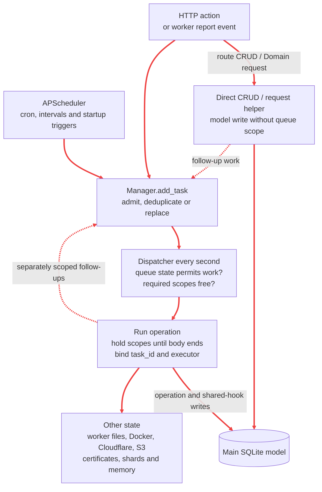
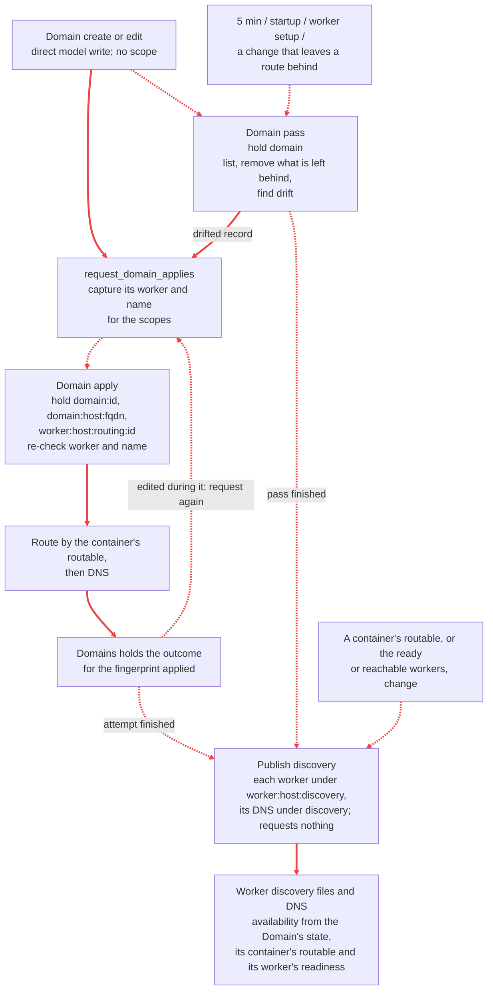
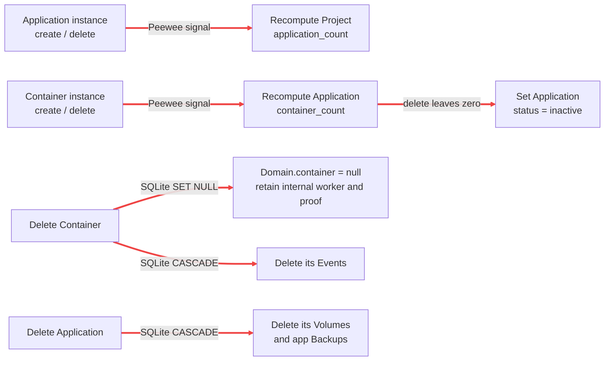
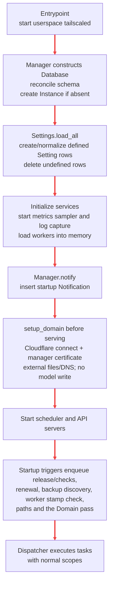

# Scheduler and data writes

This is the reference for **what starts work, which work can overlap, and which state it changes**.
The diagrams show the main flows; the tables list every queued operation and the writers outside the queue.
Names in code font are searchable function, task or model names.

- [Execution flow](#execution-flow)
- [Scopes and admission](#scopes-and-admission)
- [Scheduler timetable](#scheduler-timetable)
- [Task catalog](#task-catalog)
- [Follow-up flows](#follow-up-flows)
- [Synchronous routes](#synchronous-routes)
- [Startup and other writers](#startup-and-other-writers)
- [Model writer index](#model-writer-index)
- [Consistency boundaries](#consistency-boundaries)

## Execution flow

**Scopes protect queued task bodies. Direct route writes do not acquire queue scopes.** A task's executor
chooses its pool for blocking work; it does not determine which other tasks are excluded.

The scheduler's application and backup triggers read rows to select work; the dispatcher itself enqueues nothing.
Telegraf requests application status work, which writes rows only when its queued task runs. [Startup, ingestion and service threads](#startup-and-other-writers)
have additional write paths, including Vector's direct writes to log shards.

Task completion, failure and pending-task cancellation can create a `Task` row. **Quiet tasks record only
failure** and retain task-log lines only on failure. `Manager.notify` writes a `Notification` immediately in
its caller, then hands webhook delivery to a separate pool. Those shared effects are additional to the
operation-specific writes below; ordinary log statements do not create notifications.

Sources: [scheduler](../app/scheduler.py), [queue engine](../app/utils/queue.py),
[history writer](../app/services/history.py), [notification writer](../app/services/manager/core.py),
[pools](../app/utils/executor.py).

## Scopes and admission

`<qn>` means `Application.qualified_name` (`project-application`); `<id>` is a Domain ID;
`<manager>` is `TS_NAME`. Braces mean **all** listed scopes are held together.

| Scope | Excludes | Does not exclude by itself |
| --- | --- | --- |
| `platform` | Other `platform` work | Application, domain, common and metrics work |
| `app:<qn>` | Work for that application, and tasks holding root `app` | Other applications and the domain parent pass |
| `domain:<id>` | Work for that record, and tasks holding root `domain` | Other records |
| `domain:host:<fqdn>` | The apply of any record with that full name, so a name swapped between two records is applied by one at a time | Other names |
| `domain` | Every Domain apply, and every other task holding it: the Domain pass, maintenance | Worker and application tasks |
| `worker:<host>` | Work on that worker and every scope below it: its containers, its stack, its routes and its discovery files | Other workers |
| `worker:<host>:container:<id>`, `worker:<host>:stack`, `worker:<host>:routing:<id>`, `worker:<host>:discovery`, `worker:<host>:tls` | That one and `worker:<host>` | Their siblings: a container's operations, the stack's repair, a Domain's route, the discovery files and the certificate files on the same worker |
| `certificate:worker:<host>` | That worker's certificate copy, and `certificate` | Other workers' copies |
| `discovery` | The discovery DNS publication | Every other root, the workers' discovery files included |
| `{platform, app, domain}` | All queued platform, application and domain work | Common, metrics and work outside the queue |
| `certificate` | The certificates' renewal, and every task under it | Worker, domain and application work |
| `common:<section>` | That section and root `common` work | Other sections at the scope level |
| `common` | All common work | The other roots |
| `metrics:<host>` or `metrics:workers` | The matching child and root `metrics` maintenance | Sibling metrics tasks |
| `metrics` | All metric flushes and maintenance | The other roots |

A Domain's apply holds its route's scope under its worker, not its container's: it does not wait for the container's
operations, and the worker's convergence and reboot exclude it. The `common` pool has one thread;
async task bodies can still overlap while their offloads wait for it. Pool size is not a lock.

`*` conflicts with every queued task, one holding no scope included; the platform restore holds it.

| Admission | Effect on an operation with the same **key** (by default its name, subject ids and intent; a container's lifecycle requests share `("lifecycle", <container id>)`), whatever its scopes |
| --- | --- |
| `DEDUP` | A pending task with the key, else a running one, does the request (`existing`, with its id); otherwise enqueue. Default. |
| `REPLACE` | Supersede the pending tasks with the key, even on other scopes; keep a running one and queue its successor. |
| `REVISE` | `busy` (with the running task's id) while a task with the key runs; otherwise supersede the pending ones and enqueue. |
| `QUEUE` | Keep every request. |

Pending tasks can be cancelled by key, name, or a scope and the scopes below it (`cancel_tasks`); the Manager cancels a container's queued Deploy, Stop or Delete on request, and every queued task of a container when it is deleted.

A visible request joining a quiet task with its key makes that task visible. Conflicting scopes defer admitted work; they do not reject it. Pending tasks reserve no scopes, so a broad
task can wait while later work starts. Paused queues admit work but start nothing; restoring starts only the
restore; stopping cancels pending/new work and drains running tasks. The main API refuses mutations while
the queue is not running, except pause/resume. The separate ingestion API keeps accepting pushes.
See [queue semantics](backend.md#operation-queue) and [pause/restore/stop](backend.md#pause-and-stop).

## Scheduler timetable

Times below are **the manager process's scheduler timezone**: `AsyncIOScheduler` has no explicit timezone
override. Volume crons are matched against naive UTC from `utcnow()`. They agree when the manager uses UTC.
Cron rows fire at wall-clock boundaries; interval rows run relative to scheduler start. These are enqueue
times, not execution deadlines. APScheduler coalesces missed fires, permits one instance per trigger, and
uses a 30-second misfire grace period.

| Trigger | Cadence | Also once at scheduler startup? | Work selected |
| --- | --- | --- | --- |
| `dispatch_tick` | Interval 1 s | No | Start eligible queued operations; no task of its own |
| `observe_workers` | Interval 30 s | No | `observe_workers` |
| `refresh_worker_paths` | Interval 60 s | Yes | `refresh_worker_paths` |
| `observe_containers` | Every minute, `* * * * *` | No | `observe_containers` |
| `list_container_records` | Every 10 minutes, `*/10 * * * *` | No | One `list_records` per worker whose report is current |
| `schedule_application_backups` | Every minute, `* * * * *` | No | One `backup_application_s3` per app with due volumes; S3 required |
| `collect_metrics` | Every minute, `* * * * *` | No | `collect_self` and `flush_worker_metrics` |
| `reconcile_domains` | Every 5 min, `*/5 * * * *` | Yes | `reconcile_domains` |
| `check_settings` | Every 5 min, `*/5 * * * *` | Yes | `check_<section>` for each configured section |
| `refresh_latest_release` | Every 4 h, `0 */4 * * *` | Yes | `refresh_latest_release` |
| `backup_database` | 00:00 and 12:00, `0 */12 * * *` | No | `backup_database_s3`; S3 required |
| `renew_certificates` | Daily 03:00, `0 3 * * *` | Yes | `renew_certificates` |
| `cleanup` | Daily 04:00, `0 4 * * *` | No | Three independent tasks: `metrics_cleanup`, `logs_cleanup`, `cleanup` |
| `send_summary_notification` | Daily 08:00, `0 8 * * *` | No | `send_summary_notification` |
| `discover_backups` | Startup only | Yes | `discover_s3_backups`; S3 required |

Due volume backups require an active/inactive application with containers, a matching `Volume.backup_cron`, and
no Backup for that app/volume already recorded in that UTC minute. Due volumes are grouped into one app task.
`croniter` uses Sunday = 0 for these expressions; APScheduler's numeric weekday 0 means Monday.
Sources: [trigger definitions](../app/scheduler.py), [due-volume selection](../app/services/manager/backups.py).

## Task catalog

Each operation appears once below, with source-dependent admission variants in its row. **Q** means quiet;
**H** means normal terminal history. Sources listed as follow-ups enqueue independent tasks. An inline call
is part of its caller and acquires no additional scope. Table effects exclude the shared Task/Notification
effects described [above](#execution-flow).

### Applications and volumes

Implementation: [container lifecycle](../app/services/manager/containers.py),
[application operations](../app/services/manager/application.py),
[backup/restore operations](../app/services/manager/backups.py).
Route paths use `<app>` for `/projects/{project}/applications/{application}`; all paths are under `/api`.

| Operation | Scopes · executor | Admission / history | Every initiating source | Model writes and other effects |
| --- | --- | --- | --- | --- |
| `deploy` (`deploy_container`) | `worker:<host>:container:<id>` · app | REVISE on `("lifecycle", <id>)` / H | `request_deploy`, `request_deploy_all` | ContainerEvents (admitted, rejected, succeeded, failed); no other main-DB write. Reads and writes the worker's `record.json`; stops the container, writes `.env`, secrets, Compose file and volume directories, `compose up`, verifies; the `Containers` owner holds the record. |
| `stop` (`stop_container`) | `worker:<host>:container:<id>` · app | REVISE on `("lifecycle", <id>)` / H | `request_stop`, `request_stop_all` | ContainerEvents; the worker's `record.json`; `compose down`, verifies nothing runs. |
| `delete` (`delete_container`) | `worker:<host>:container:<id>` · app | REPLACE on `("delete", <id>)`, after cancelling the container's queued tasks / H | `request_delete` | ContainerEvents; the worker's `record.json`; `compose down --volumes --rmi local --remove-orphans`, removes the placement directory; then deletes the Container row through `detach_container` (unlinks its Domains) and requests their applies and, when it unlinked any, `reconcile_domains`. Force on a worker that can't be asked: only the row. |
| `observe_containers` | none · app | DEDUP / Q | Every minute | No main-DB write. Decides every container's state, tells the pages of those whose state changed, and asks for each container's correction: a record read, a recovery or a reset. Holds each recovery's first-seen time. |
| `recover` (`recover_container`) | `worker:<host>:container:<id>` · app | DEDUP on `("recover", <id>)` / H | `observe_containers`: at an interrupted operation or unreadable record, then once its allowance has passed | ContainerEvents; the worker's `record.json` (recovering, then settled stopped/failed); `compose down` and the check. |
| `reset` (`reset_container`) | `worker:<host>:container:<id>` · app | DEDUP on `("reset", <id>)` / H | `observe_containers`: a runtime that contradicts its record, or a record from before a restore | ContainerEvents; reads the record and inspects the runtime again; `compose down`, the check, the record with the cause. |
| `read_record` | `worker:<host>:container:<id>` · app | DEDUP / Q | `observe_containers` (a record never read, or whose read failed while the worker reports); `list_records` (a listed record that differs) | No main-DB write. Reads the container's `record.json`; the `Containers` owner holds it. |
| `list_records` | none · app | DEDUP / Q | Every 10 minutes, for each worker whose report is current | No main-DB write. Lists every placement directory and record on the worker; requests `read_record` for a container whose listed record differs from the held one and `cleanup_orphan` for this Sage's placements with no row. |
| `cleanup_orphan` | `worker:<host>:container:<id>` · app | DEDUP on `("cleanup_orphan", <host>, <id>)` / H | `list_records`; `observe_containers` (a reported runtime labelled as this Sage's with no row) | No main-DB write. Re-checks the row and the owner; `compose down --volumes --rmi local --remove-orphans` by project name, the check, removes the placement directory. Waits out an unsettled operation's allowance first. |
| `backup_application_s3` | `app:<qn>` · app | DEDUP / H | Due-volume scan every minute; POST `<app>/volumes/{volume}/backups` | Application/Container `status` during backup and runtime recovery; backup Events; one Backup per successful container-volume archive. Upload encrypted worker archives, restore runtime; failed runtime recovery can leave error status. The stop helper skips containers already marked backup; see [consistency boundaries](#consistency-boundaries). Manual route requires inactive app. |
| `restore_application_volume_from_s3` | `app:<qn>` · app | DEDUP / H | POST `<app>/volumes/{volume}/backups/{backup}/restore` | Application and target Container `status` become restoring; restore Event; restore worker volume; finally restore saved statuses, including on failure. Does not create a Backup. Requires inactive app. |

A change of whether a container with a service's Domain can be routed to publishes discovery again. Application/Container write helpers emit the affected UI sources; container log markers go
to the application's log shard on `LOGS_EXECUTOR`. No deployment follows an ordinary configuration edit.

### Domains and discovery

Implementation: [Domain operations and request helpers](../app/services/manager/domains.py).

| Operation | Scopes · executor | Admission / history | Every initiating source | Model writes and other effects |
| --- | --- | --- | --- | --- |
| `apply_domain` | `domain:<id>`; `domain:host:<fqdn>` when it has a name; `worker:<host>:routing:<id>` when it routes to a worker · app | REPLACE on `("apply_domain", <id>)` / Q | `request_domain_applies`: the end of a container's Deploy or Stop, either one's failure, and its Delete (the Domains it unlinked); `observe_containers` when a container becomes routable or stops being; a worker's subdomain change (its internal and TCP Domains); `reconcile_domains` (a Domain in error, drifted or not applied); its own follow-up after an edit during it or a move before it | No main-DB write. `domain-<id>.yml` on its worker: written while its container is routable, removed once it is not or the Domain is unlinked, left as it is while that is unknown or the worker is not reachable and set up. Then its `sage-domain-<id>` DNS records: a linked public name's CNAME to its worker's tunnel, none otherwise. The `Domains` owner holds the outcome for the fingerprint applied (a success only when the route was applied too) and what it did to the route and DNS. A failure fails the task and is not retried by itself. |
| `reconcile_domains` | `domain` · app | REPLACE on `("reconcile_domains",)` / Q | `request_domain_reconciliation`: every 5 min and startup; the end of a worker's setup; a container Delete that unlinked Domains; Domain edits and deletes | No main-DB write. Lists the routing files on each worker reachable and set up, the zone and the tunnels, then reads the Domain rows. Removes the routing files of Domains gone or bound to another worker (one `rm -f` per worker) and the `sage-domain-<id>` records of Domains gone. `Domains` holds each Domain's route on its worker and whether its DNS conforms, and drops what it held of Domains gone. Requests `apply_domain` for each Domain in error, drifted or not applied. A failed listing or removal fails the task after the rest ran. |
| `publish_discovery` | `worker:<host>:discovery` · app | REPLACE on `("publish_discovery", <host>)` / Q | `request_discovery`, for each worker reachable and set up: the end of every Domain apply and Domain pass; `observe_containers` when whether a container with a service's Domain can be routed to changed; a change of the ready workers or of those reachable and set up (worker observation and reports) | No main-DB write. Re-checks the worker; reads its `discovery` stamp and lists its `_discovery-*.yml` files; when either differs from the current services, writes each service's file, removes the stale ones, then writes the stamp. Requests nothing. |
| `publish_discovery_dns` | `discovery` · app | REPLACE on `("publish_discovery_dns",)` / Q | `request_discovery`, with every request | No main-DB write. One zone listing: `discovery.int.<domain>` A records to each worker reachable and set up under `sage-discovery-<host>` (any other worker's deleted), and `discovery.<domain>` CNAME to the platform tunnel under `sage-tunnel`. |

A request writes nothing: a Domain's status is decided when it is read. See the [Domain flow](#domain-apply-and-discovery).

### Workers and certificates

Implementation: [worker operations](../app/services/manager/workers.py),
[certificate operations](../app/services/manager/certificates.py).

| Operation | Scopes · executor | Admission / history | Every initiating source | Model writes and other effects |
| --- | --- | --- | --- | --- |
| `observe_workers` | none · app | DEDUP / Q | Interval 30 s | No main-DB write. Asks every configured worker's SSH server (`Tailscale.observe_workers`), drops the setup outcome of a worker that stopped answering, tells the pages of the workers whose state changed (observed status changes are WorkerEvents), and requests `converge_worker` and `repair_worker_stack`. |
| `converge_worker` | `worker:<host>` · app | DEDUP / Q; force on its own key `("converge_worker", <host>, "force")` / H | `observe_workers` (not set up since the start or since it came back, a new address, a failed or refused setup after the retry time); force: Resync workers | No main-DB write. Owner stamp; removes the routing files of Domains gone or bound to another worker; worker tunnel and `*.<subdomain>.int` record (Cloudflare), the stack's files, `compose up --wait` and restarts and the infra stamp when it differs or on force, else `compose up -d`; the setup outcome and applied address in `Workers`, and the proofs of its `certs` stamp; WorkerEvents. Requests `renew_certificates` when its own or the discovery certificate does not cover its names, else `distribute_certificates` when it did not apply the current ones; once set up, `reconcile_domains`. |
| `repair_worker_stack` | `worker:<host>:stack` · app | DEDUP / Q | `observe_workers`: set up but not ready for its stack, Traefik or a minute's silence, once per cooldown | No main-DB write. `compose up -d` of the stack's services; a repair WorkerEvent when it started something. |
| `add_worker` | `worker:<host>` · app | DEDUP / H | `request_add_worker` (the command writes the row first) | Looks at the worker, then the first convergence inline; WorkerEvents. A worker whose first setup fails is kept. |
| `remove_worker` | `worker:<host>` · app | DEDUP / H | `request_remove_worker` (refused with containers or internal domains) | Deletes the Worker row through its command; stops the stack and removes Sage's home when it answers and is this Sage's; deletes its DNS records and tunnel; the sources forget it; WorkerEvents. |
| `reboot_worker` | `worker:<host>` · app | DEDUP / H | `request_reboot` | No main-DB write but WorkerEvents. Boot id before, one reboot, the boot id again until a new one, inline convergence, readiness on a report after the new boot, within `WORKER_REBOOT_LIMIT_SECONDS`; application log markers. |
| `refresh_worker_paths` | none · app | DEDUP / Q | Interval 60 s and startup | No main-DB write. Pings the reachable workers for their paths and tells the pages of the workers whose state changed. |
| `renew_certificates` | `certificate` · platform | REPLACE on `("renew_certificates",)` / H | `request_certificate_renewal`: daily 03:00 and startup; a worker's removal or subdomain change; a worker's setup when its own or the discovery certificate does not cover its names; successful restore; inline from `refresh_traefik` | No main-DB write. The worker names from the Worker rows; then one certificate at a time: retire what no longer covers its names (a removed worker's found on disk included), revoking its public leaf, and issue what is missing or due; the manager's TLS reloaded in place when it was issued; then `distribute_certificates` requested for each worker reachable and set up. A failed retirement holds back that certificate's issue only; any failure fails the task after the rest ran. |
| `distribute_certificates` | `certificate:worker:<host>`, `worker:<host>:tls` · app | REPLACE on `("distribute_certificates", <host>)` / Q; forced on its own key with `"force"` / H | `request_certificate_distribution`: the end of `renew_certificates`, for each worker reachable and set up; `converge_worker` when the worker did not apply the current certificates | No main-DB write. Re-checks the worker; reads its `certs` stamp, its managed files and its `certs.yml` digest; when any differs (or forced), copies each valid pair, writes the list, removes unwanted files, then the stamp; `Workers` holds the proofs applied. |
| `refresh_traefik` | `{platform, app, domain}` · platform | DEDUP / H | POST `/settings/resync_traefik` | Inline certificate maintenance; rewrite worker Traefik config and wildcard DNS. Through request helpers, mark all Domains pending/clear errors and enqueue their syncs plus full discovery. Does not advance infra stamps. |

`save_worker_subdomain` also runs directly in the [worker update route](#synchronous-routes).

### Platform, settings and maintenance

Implementation: [platform operations](../app/services/manager/platform.py),
[settings checks](../app/services/manager/settings.py), [release/summary](../app/services/manager/core.py),
[metrics](../app/services/metrics.py), [log maintenance](../app/services/logs/store.py).

| Operation | Scopes · executor | Admission / history | Every initiating source | Model writes and other effects |
| --- | --- | --- | --- | --- |
| `backup_database_s3` | `{platform, app, domain}` · platform | REPLACE / H | 00:00/12:00; POST `/backups`; S3 required | SQLite snapshot, encrypt and upload, then insert platform Backup. Snapshot precedes its own Backup/history rows. |
| `restore_database_from_s3` | `{platform, app, domain}` · platform | DEDUP / H; `restore=True` | POST `/backups/{backup}/restore` | Replace **all main-DB tables** using SQLite backup API, with safety-copy rollback. Reconcile schema/Instance and normalize Settings; write back pre-restore S3 settings. Reload settings consumers and workers. Successful restore cancels waiting old-data work and enqueues renewal, force worker sync, full discovery and S3 discovery with priority. |
| `discover_s3_backups` | `{platform, app, domain}` · platform | DEDUP / H | Startup; POST `/backups/discover`; PUT `/settings/s3`; successful restore; S3 required | Bulk insert missing platform/app Backup rows, delete rows whose object is absent. Volume archives are linked only when their app exists, using names in the S3 key. |
| `delete_backup_s3` | `common` · common | QUEUE / H | DELETE a platform or nested volume backup | No operation-specific main-DB write. Delete S3 object; its Backup row was already deleted by the route. |
| `check_<section>` → `check_setting` | `common:<section>` · common | REPLACE; periodic/startup Q, save H | Every 5 min and startup for configured sections; PUT `/settings/{s3,notifications}` when complete | No main-DB write. Set in-memory check result/time; Cloudflare check also updates cached tunnel health and worker entries. Sections: tailscale, cloudflare, s3, notifications. |
| `refresh_latest_release` | `common` · common | REPLACE / H | Every 4 h and startup; POST `/info/release/refresh` | No operation-specific main-DB write. Fetch and replace in-memory release/version cache. |
| `send_summary_notification` | `common` · common | REPLACE / H | Daily 08:00 | Read model/cached worker counts and dispatch summary directly to notification channels. **No Notification row** for the summary. |
| `collect_self` → `Metrics.collect_self` | `metrics:<manager>` · metrics | DEDUP / Q | Every minute via `collect_metrics` | No main-DB write. Flush completed manager sample minutes into its metrics shard (`WorkerMeta`, `WorkerMetrics`). |
| `flush_worker_metrics` | `metrics:workers` · metrics | DEDUP / Q | Every minute via `collect_metrics` | No main-DB write. Flush completed report minutes into worker metric shards (`WorkerMeta`, `WorkerMetrics`, `ContainerMetrics`); push newest host metrics into worker memory. |
| `metrics_cleanup` → `Metrics.cleanup` | `metrics` · metrics | REPLACE / Q | Daily 04:00 | No main-DB write. Delete old metric rows and orphan host shards; read Worker rows to identify live hosts. |
| `logs_cleanup` → `Logs.cleanup` | `common` · common | REPLACE / Q | Daily 04:00 | No main-DB write. Delete old log/request/task-log lines and orphan application shards; trim size limits and optimize indexes. |
| `cleanup` | `platform` · platform | REPLACE / H | Daily 04:00 | Delete old Event, Notification, Backup and Task rows; remove old DB safety copies and S3 archives. Default retention: `config.RETENTION_DAYS` = 14. Does not hold `app`, `domain`, `common` or `metrics`. |

## Follow-up flows

### Domain apply and discovery

Solid arrows show work within a path; dashed arrows enqueue a separate task. A parent never waits for a child
while holding `domain`, since that scope excludes every child's `domain:<id>`.

A Domain whose worker or name changed after its request is requested again with the right scopes before any I/O. A
container's operation does not hold the apply back: the route follows its `routable` when the apply runs, and a change
of that requests the apply again. Failed applies, and routes left because the worker could not be written to or the
container's state was not known, wait for the Domain pass. Discovery's publication only reads results and requests
no apply, so a failed apply cannot form a retry loop through it. Domain apply proof and discovery availability remain
separate facts.

### Application and worker events

| Event / writer | Immediate state change | Queued consequence |
| --- | --- | --- |
| Deploy or Stop end, or the failure of either | The worker's `record.json` | Apply the container's Domains |
| `observe_containers`: a container becomes routable or stops being | None | Apply its Domains (a change between known values); publish discovery (any change, its becoming known included, of a container with a service's Domain) |
| Successful container delete | Delete row; FK unlinks Domains; signals update count/status | Apply the unlinked Domains; the Domain pass when there were any |
| A worker's readiness changes | None | Publish discovery; the Domains routed to it are shown again |
| Worker setup or offline transition | Worker row/IP or cached online state; remote convergence, which removes the routing files of Domains gone or bound elsewhere | After a setup, the Domain pass; publish discovery when the workers reachable and set up, or their addresses, change, its DNS membership with them |
| Worker subdomain edit | Worker row | Convergence; apply its internal and TCP Domains, whose ends publish discovery; renewal |
| Worker setup whose own or discovery certificate does not cover its names | None | Certificate renewal |
| Worker removal | Deletes the Worker row | Certificate renewal, which retires its leaf |
| Domain apply ends | `Domains` holds its outcome for the fingerprint applied | Apply again when the Domain was edited during it; publish discovery |
| Domain pass ends | `Domains` holds what it saw of each Domain's route and DNS | Apply each Domain in error, drifted or not applied; publish discovery |

Queue-derived worker intent does not enqueue discovery inside its Fact callback. The next ordinary report or
worker refresh checks readiness. [Worker ownership](../app/services/manager/workers.py) and
[application writers](../app/services/manager/application.py) own these triggers.

## Synchronous routes

**No queue scopes are held by these writes**, even if they call a Manager helper. All paths have `/api`
prefix; `<app>` has the expansion given in the catalog. Notifications, requests, tasks and info expose no
ordinary CRUD writer beyond the action routes already listed.

| Route | Rows/fields written before the response | Immediate or queued consequence |
| --- | --- | --- |
| POST `/projects` | Project: derived immutable `name`, `label`, `description`, defaults | No queued operation |
| PUT `/projects/{project}` | Project `label`, `description`, `env` | Notify app/worker views; deploy inputs apply on next deploy |
| DELETE `/projects/{project}` | Delete Project; refused while it has applications | No queued operation |
| POST `<app collection>` | Application: parent project, derived immutable `name`, `label`, `description`, defaults | Signal recomputes Project `application_count`; publish application change |
| PUT `<app>` | Application `label`, `description`, deploy configuration (`type`, `image`, `repo`, `path`, `env`, `args`, `build_secrets`, `command`) | Model normalizes type-dependent fields; notify app/worker views; no deploy enqueued |
| DELETE `<app>` | Delete Application; refused while busy or with containers | Cascade Volumes and app Backups; signal recomputes project count; S3 archives remain |
| POST `<app>/containers` | Container `application`, `worker`, default inactive status | Signal recomputes Application `container_count`; publish container change; no deploy/domain work |
| POST/PUT/DELETE `<app>/volumes[/{volume}]` | Volume create/update/delete: `name`, `path`, `backup_cron`, parent app on create | Publish application change; no remote volume operation. Deploy uses current mounts; due-backup scan reads current cron |
| POST `/domains` | Domain `name`, `type`, `port`, `container`, `service`, `pool`, `cors_origins`; defaults pending with null proof | Derive internal worker / clear public worker; request full discovery and record sync |
| PUT `/domains/{id}` | Sent config/link fields; `status=pending`, `sync_error=null`; retain successful proof | Validate/derive namespace and CORS; notify old/new linked apps; request full discovery and record sync |
| DELETE `/domains/{id}` | Delete Domain | Request parent cleanup/discovery; ID-owned artifacts allow cleanup after row removal |
| PUT `/workers/{host}` | Worker `subdomain` via `save_worker_subdomain`; affected Domain pending/error-clear writes via request helper | Update worker cache; enqueue record syncs, discovery, renewal and stamp-check worker sync |
| PUT `/settings/{s3,notifications}` | Setting `value` (merged known fields) through `Settings.set` | Validate first, reload consuming service immediately, enqueue check when complete; S3 save also requests backup discovery |
| DELETE `/backups/{id}` or nested volume backup | Delete Backup immediately | Emit backups change; queue `delete_backup_s3` with S3 path |

`<app collection>` is `/projects/{project}/applications`. Route action endpoints such as deploy, stop,
add/remove worker and backup/restore enqueue without changing their target rows in the route.
Pause/resume change only queue memory. `POST /settings/{section}/test` validates/tests provided values against
the provider without persisting them; its test message bypasses the Notification table.

### Implicit model writes

These run as part of the initiating write, with that writer's scopes (or none). Sources:
[models and foreign keys](../app/services/db/models.py), [Peewee signals](../app/services/db/signals.py),
[generic route helpers](../app/utils/api.py).

`BaseModel.save` advances `updated_at`; dirty-field saving preserves unrelated columns. Query-level updates,
bulk inserts/deletes and SQLite FK actions do not invoke instance `save` or the instance signals. In particular,
counter signals use direct SQL updates, and Domain unlinking does not run `Domain.save`, mark pending or emit
its own UI source. `detach_container` publishes the container's pages after deletion.

## Startup and other writers

### Startup

Schema reconciliation creates missing tables/columns/indexes and drops undeclared columns/indexes in a
transaction; it also creates the persistent Instance identity when absent. Settings loading creates missing
defined rows/fields and removes undefined rows/fields. This is synchronous boot work with no queue scope.
Loading worker memory can already enqueue discovery; nothing dispatches until the scheduler starts.
The startup trigger list is not a promise that those operations finish in list order.

Startup does **not** bulk-reset Application/Container statuses. The regular app-scoped status reconciler owns
interrupted-operation recovery. Platform restore runs schema/settings loading again under its broad scopes,
replaces all model rows, and reloads the dependent in-memory owners. Certificates, metric shards and log shards
are outside the platform DB snapshot.

Sources: [entrypoint](../app/entrypoint.sh), [process startup](../app/main.py),
[Manager initialization](../app/services/manager/__init__.py), [schema](../app/services/db/database.py),
[settings loading](../app/services/settings.py).

### Ingestion, threads and shared hooks

| Process / source | Cadence or trigger | Queue scopes | Writes |
| --- | --- | --- | --- |
| Telegraf report intake | Worker report interval, 10 s (`REPORT_INTERVAL_SECONDS`) | None | WorkerReports snapshots and metric peaks in memory; worker cached report/readiness. The pages of the containers a report changed are told; readiness changes can enqueue discovery. No direct main-DB rows. |
| Vector log intake | Worker batch, up to 10 s batching delay; pushes can also flush when full | None; `LOGS_EXECUTOR` | Request/application log shards, with FTS triggers for application lines; post-write size trimming can delete old lines. No main-DB rows. |
| Manager metric sampler | Service-owned daemon, every 5 s (`METRICS_SAMPLE_INTERVAL`) | None | In-memory minute peaks only; queued `collect_self` persists them |
| Task-log capture | Service-owned drain thread, on captured task log lines | None | `logs/tasks.db`; quiet-task lines released on failure; post-write size trimming |
| `mark` / `Logs.write_marker` | Deploy, stop, delete, stale-version stop, backup stop/start, volume restore, reboot | Caller retains scopes while awaiting `LOGS_EXECUTOR` | Application log shard; best-effort marker |
| `Manager.notify` | Explicit call from an operation or startup | Caller scopes; none at boot | Notification row immediately, notification feed, then webhook dispatch on `NOTIFICATIONS_EXECUTOR` |
| Queue terminal hook | Completion, failure, supersession, restore cancellation or shutdown drain | No new scope; hook can run during enqueue/cancellation as well as task execution | Task history row/feed; quiet completion/cancellation omitted. Running/queued states are memory only |
| Lazy shard open | First metric/log access, including reads | Caller scopes or none | Create shard file, tables and indexes when absent; no main-DB rows |

Sources: [Telegraf route](../app/routes/telegraf.py), [Vector route](../app/routes/vector.py),
[metrics](../app/services/metrics.py), [task capture](../app/services/logs/tasks.py),
[log storage](../app/services/logs/store.py). Socket.IO loaders read state and emit it; they are not model writers.

## Model writer index

This is the reverse lookup: start with a model to find all its normal writers. **Platform restore can replace
every row below**, and schema reconciliation can change every table. Shared timestamps and the implicit
writes above apply in addition to the listed fields.

| Model | Direct route writer | Queued / shared writer | Other writer |
| --- | --- | --- | --- |
| `Setting` | Settings PUT: merged `value` | Platform restore preserves pre-restore S3 value | `Settings.load_all/load` at boot/restore: row/field normalization |
| `Instance` | None | Restore may supply identity | Schema reconciliation creates identity if absent |
| `Worker` | Worker PUT: `subdomain` | Add/convergence: insert or IP update; sync: fill null subdomain; remove/failed-new-setup rollback: delete | Worker health/status is memory, not a Worker column |
| `Project` | Project CRUD: configuration | None directly | Application instance create/delete signal recomputes `application_count` |
| `Application` | Application CRUD: configuration/defaults | Backup/volume restore: `status` | Container instance create/delete signals recompute `container_count`; last delete sets inactive |
| `Container` | Create placement | Delete: delete row (`detach_container`); backup/restore: `status`; remove-worker: delete row | No direct report-to-row write |
| `Domain` | Domain CRUD through its commands, which derive the namespace worker and CORS policy | None: an apply's outcome and what it saw are memory (`Domains`) | Container deletion (`detach_container`) clears `container` by FK |
| `Volume` | Volume CRUD: mounts and backup cron | None directly | Application FK deletion cascades row deletion |
| `Backup` | Backup DELETE | Volume/platform backup inserts; S3 discovery inserts/deletes; retention deletes | Application FK deletion cascades app Backup deletion |
| `Event` | None | `container_part` inserts deploy/stop/delete/backup/restore parts; retention deletes | Container FK deletion cascades Events |
| `Notification` | None | `Manager.notify` inserts; retention deletes | Startup calls `notify`; summary/test dispatch creates no row |
| `Task` | None | Queue terminal hook inserts; retention deletes | Pending-task cancellations can invoke hook on producer/shutdown thread |

## Consistency boundaries

These are useful places to check when changing a flow:

- **A scope is not a database lock.** Direct config writes, pending-state helpers, signal updates and FK actions
  can overlap queued work. Deploy captures a transaction snapshot; Domain apply re-checks its worker and name
  and holds its outcome for the fingerprint it applied, so an edit during it is never certified by it. CRUD does not implicitly join these scopes.
- **A broad barrier covers three roots.** Common work, metric flushes and ingestion remain independent of
  `{platform, app, domain}`. The restore queue state stops new ordinary tasks, but already running unrelated
  tasks and ingestion are separate writers. The main API gate does not drain a route already in progress.
- **Inline work keeps its caller's scope.** Normal worker removal holds the broad barrier; failed-new-worker
  setup rollback calls that same method while holding only `platform`. Its preconditions and reachable writes
  must be assessed in that context.
- **Missing-target behavior varies.** Deploy, Stop and Delete of a container, Domain sync and app backup
  explicitly use `get_or_none` and return for a missing target. Volume restore uses `get_by_id` for its inputs,
  so a vanished target raises and fails its task. A uniform quiet-no-op policy
  is not implemented across all entity operations.
- **Backup state and stop eligibility disagree.** `backup_application_s3` persists each Container as `backup`,
  then re-fetches it for `_stop_container_for_backup`. That helper returns unless the row is `active`, so this
  path skips the remote stop before archiving an active application's volumes. A `backup` status does not
  establish that the runtime is stopped. See [the backup implementation](../app/services/manager/backups.py).
- **Row deletion does not imply artifact deletion.** Backup DELETE removes its row before queued S3 cleanup;
  Application deletion cascades Backup rows without deleting S3 objects; S3 discovery can list matching objects
  again. Container and Domain deletion use separate follow-ups to remove routing artifacts.
- **Writes have different publication owners.** Model signals/FK actions do not emit UI changes; the operation
  that initiated them supplies those events. Manager row writers, route CRUD and bulk restore/discovery paths
  each publish explicitly. See [pushed updates](backend.md#pushed-updates).
- **Operation state has several stores.** Pending/running tasks, worker readiness and Domain results are memory;
  app/container busy statuses are persistent; `syncing` is projected from queued Domain work. A synced Domain can be
  unavailable. Quiet task absence from history is not evidence that no work ran.
- **Intervals and retries are separate.** The catalog's admission is explicit for each source: report-driven
  status uses REPLACE even at minutely cadence; discovery's publication uses REPLACE on its own keys and requests no apply. A future
  change must preserve a follow-up for edits during I/O without creating a parent/child retry loop.

The diagrams describe the source's current behavior. For a change, follow both directions: trigger → scopes →
writer → follow-up, and model → every writer → publication. The linked source files make each edge inspectable.
